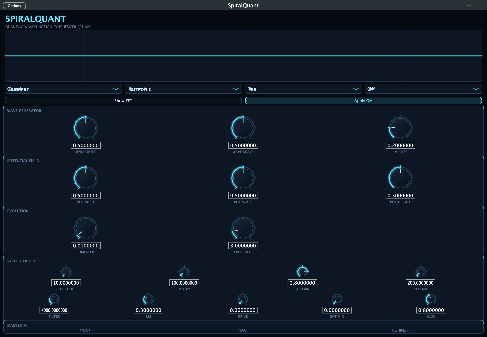

# SpiralQuant

**SpiralQuant** is a polyphonic software synthesizer plug-in built with [JUCE](https://juce.com/).
Instead of a classic wavetable, each voice's oscillator is a complex-valued
solution of the 1D time-dependent Schrödinger equation, evolved in real time with
a split-step Fourier method on a 128-point grid.

## UI



## Formats

- VST3
- AU (macOS)
- Standalone application
## Sound engine

- **8-voice polyphony** with oldest-voice stealing.
- **MIDI note input**; pitch mapped from MIDI note to frequency.
- **Oscillator (`QuantumOsc`)**: 128-sample complex wavetable (`|ψ|`, `Re ψ`, `Im ψ`,
  magnitude, phase), normalised after every timestep.
- **Initial wave shapes**: Gaussian, Sine, Cos, Parabola, Saw, Square.
- **Potentials**: Flat, Harmonic, Infinite Well, Barrier, Double Well, Linear
  (with scale/shift/height controls).
- **Evolution**: split-step Fourier (potential half-step in position space, kinetic
  step in momentum space); optional FFT view keeps the table in momentum space.
- **Readout modes**: Real, Imaginary, Magnitude, Phase.
- **Per-voice envelope**: ADSR.
- **Filter/saturation**: resonant low-pass, drive, saturation mix, master gain.
- **Scope**: 128-point `|ψ(x)|` plus a `|ψ(k)|` momentum spectrum with a harmonic
  frequency grid, fed by a double-buffered snapshot of the first active voice.
- **Chord mode**: each key triggers a just-intonation voicing — consonant chords
  (Power, Major, Minor, Sus4, Major 7th) and dissonant ones (Tritone, Cluster,
  Pythagorean); extra degrees get a velocity falloff.
- **Pitch shift**: ±2400 cents applied as `f · 2^(cents/1200)` at note start and
  on every change.
- **Tunneling**: Gamow transparency `T = exp(-2κL)` leaks the wave through the
  potential barrier instead of hard-reflecting it (κ from `√(2m(V−E))`).
- **Preset browser**: factory presets embedded at build time, user presets saved
  as `.sp303preset` JSON in the app-support folder.

## Parameters

| ID                   | Type     | Range / choices                               | Default |
| -------------------- | -------- | --------------------------------------------- | ------- |
| `waveType`           | choice   | Gaussian / Sine / Cos / Parabola / Saw / Square | 0 (Gaussian) |
| `waveShift`          | float    | 0.0 – 1.0                                     | 0.5     |
| `waveScale`          | float    | 0.0 – 1.0                                     | 0.5     |
| `waveImpulse`        | float    | 0.0 – 1.0                                     | 0.2     |
| `potentialType`      | choice   | Flat / Harmonic / InfiniteWell / Barrier / DoubleWell / Linear | 1 (Harmonic) |
| `potentialShift`     | float    | 0.0 – 1.0                                     | 0.5     |
| `potentialScale`     | float    | 0.0 – 1.0                                     | 0.5     |
| `potentialHeight`    | float    | 0.0 – 1.0                                     | 0.5     |
| `showFFT`            | bool     | —                                             | false   |
| `sampleMode`         | choice   | Real / Imag / Magnitude / Phase               | 0 (Real) |
| `timestepDelta`      | float    | 0.001 – 0.2                                   | 0.01    |
| `samplesPerTimestep` | float    | 0.1 – 64                                      | 8       |
| `applyWavefunction`  | bool     | — (off freezes evolution)                     | true    |
| `attack`             | float    | 1 – 2000 ms                                   | 10      |
| `decay`              | float    | 1 – 2000 ms                                   | 100     |
| `sustain`            | float    | 0.0 – 1.0                                     | 0.8     |
| `release`            | float    | 1 – 5000 ms                                   | 200     |
| `filterFreq`         | float    | 20 – 20000 Hz                                 | 4000    |
| `filterRes`          | float    | 0.0 – 1.0                                     | 0.3     |
| `drive`              | float    | 0.0 – 1.0                                     | 0.0     |
| `satMix`             | float    | 0.0 – 1.0                                     | 0.0     |
| `gain`               | float    | 0.0 – 2.0                                     | 0.8     |
| `fxType`             | choice   | Off / Flanger / Phaser / Bitcrush / Fractal  | 0 (Off) |
| `fxDepth`            | float    | 0.0 – 1.0                                     | 0.5     |
| `fxRate`             | float    | 0.01 – 20 Hz                                  | 1.0     |
| `fxFeedback`         | float    | 0.0 – 0.95                                    | 0.3     |
| `fxMix`              | float    | 0.0 – 1.0                                     | 0.5     |
| `fxBits`             | float    | 2 – 16                                        | 8       |
| `fxEntropy`          | float    | 0.0 – 1.0                                     | 0.5     |
| `chordMode`          | bool     | —                                             | false   |
| `chordType`          | choice   | Power / Major / Minor / Sus4 / Major7 / Tritone / Cluster / Pythagorean | 1 (Major) |
| `pitchShift`         | float    | -2400 – +2400 cents                           | 0       |
| `tunnel`             | bool     | —                                             | false   |
| `uiSkin`             | choice   | Dark / SciFi Neon / Console (UI only)         | 0 (Dark) |

Parameters are stored in an `AudioProcessorValueTreeState`, so host automation and
state save/restore are supported.

## Building

Prerequisites:

- CMake 3.24+
- C++17 compiler
- JUCE is vendored under `vendor/JUCE/` (no separate install needed).

```sh
cmake -S . -B build
cmake --build build --config Release --parallel
```

On macOS the project builds a universal binary (`arm64;x86_64`) by default and
copies built plug-ins next to the artefacts (`JUCE_COPY_PLUGIN_AFTER_BUILD`).

## Tests

A console test target is built from `tests/TestRender.cpp`:

```sh
cmake --build build --target SpiralQuantTests --config Release
./build/SpiralQuantTests_artefacts/Release/SpiralQuantTests
```

The suite:

- renders every `waveType × potentialType × sampleMode` combination (6×6×4),
  checking for NaN/inf and non-silent output;
- renders the chord × pitch-shift × tunneling matrix;
- exercises all master FX types and a state save/restore roundtrip;
- `--bench` runs a deterministic 20 000-block, 8-voice CPU benchmark;
- `--render-logo <dir>` regenerates `resources/logo.png` and the iconset PNGs
  from the vector `LogoMark` (used to refresh `resources/icons/SpiralQuant.icns`
  via `iconutil`).

## Build options

```sh
# Aggressive math (fastest; changes denormal/FPA behaviour, NaN guards remain)
cmake -S . -B build -DSPIRALQUANT_OFAST=ON

# Profile-guided optimization:
cmake -S . -B build-pgo -DSPIRALQUANT_PGO=generate   # instrumented build
cmake --build build-pgo --target SpiralQuantTests
./build-pgo/SpiralQuantTests_artefacts/Release/SpiralQuantTests --bench   # train
xcrun llvm-profdata merge -output=pgo/default.profdata pgo/*.profraw
cmake -S . -B build-pgo -DSPIRALQUANT_PGO=use       # rebuild with profile
cmake --build build-pgo --target SpiralQuantTests
```

The default is `-O3 -fno-math-errno -ffp-contract=fast`; `-ffast-math`/-Ofast are
opt-in because the DSP relies on `isfinite` guards for NaN rejection.

It must print `ALL TESTS PASSED`.

## Build artefacts (macOS)

- `build/SpiralQuant_artefacts/Release/VST3/SpiralQuant.vst3`
- `build/SpiralQuant_artefacts/Release/AU/SpiralQuant.component`
- `build/SpiralQuant_artefacts/Release/Standalone/SpiralQuant.app`

See [How it works](docs/HOW_IT_WORKS.md) for the signal path and sound generation details.

## Presets

Preset I/O is implemented in `Source/Presets.cpp` using a small JSON format
(`PresetFormat`, version 1):

```json
{
  "format": 1,
  "name": "Example",
  "params": { "waveType": 0, "gain": 0.8 },
  "sequence": "...",
  "gate": "...",
  "credit": "..."
}
```

`presets/` is embedded at build time (when populated); an empty folder produces
no factory presets and no errors.

## Project layout

```
CMakeLists.txt
Source/
  PluginProcessor.{h,cpp}   APVTS + process block
  PluginEditor.{h,cpp}     editor + attachments
  CreateEditor.cpp         JUCE plugin entry point
  dsp/
    QuantumEngine.{h,cpp}  voice pool (8 voices)
    QuantumVoice.{h,cpp}   envelope, filter, saturation
    QuantumOsc.{h,cpp}     Schrödinger wavetable
  gui/                   palette/skins, scope canvas, ADSR editor, look-and-feel
tests/TestRender.cpp
vendor/JUCE/            vendored JUCE (do not edit)
```

## Known limitations

- When no note is held the scope shows the resting wavefunction of voice 0 rather
  than a dedicated idle animation.
